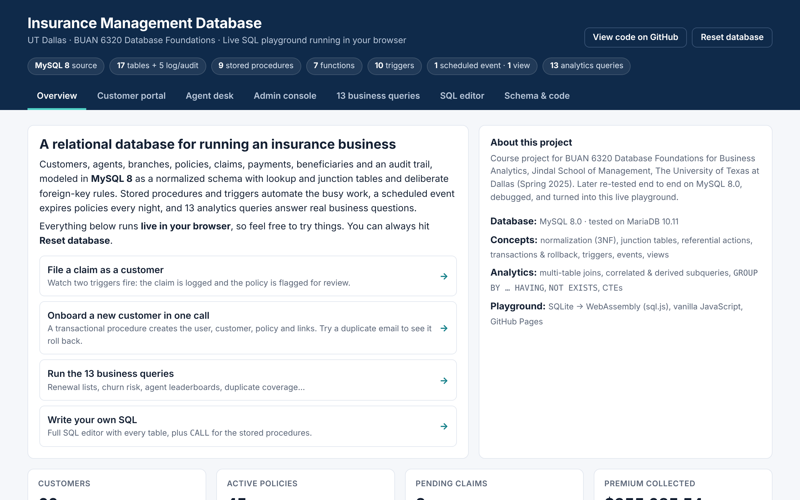
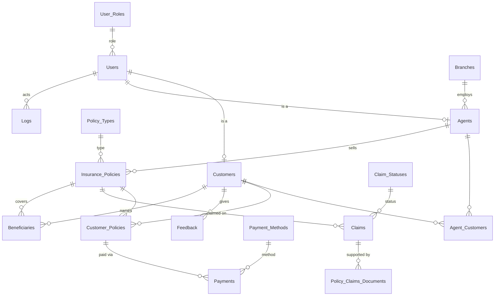
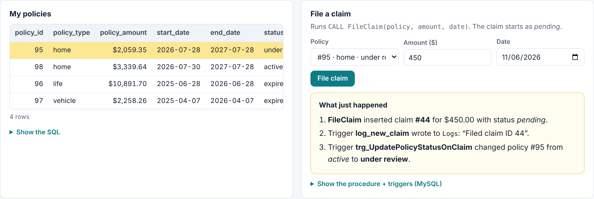
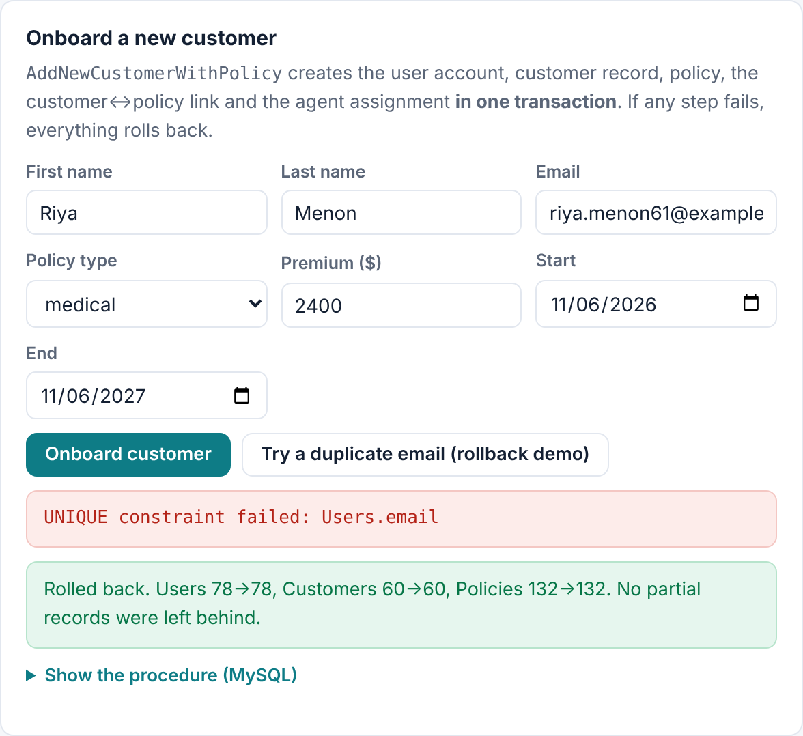

# Insurance Management Database System

**A 17-table MySQL database for running an insurance business (customers, agents, policies, claims, payments) with stored procedures, triggers, a scheduled event and 13 analytics queries.**

### ▶ [Try the live playground](https://divyasakre.github.io/insurance-management-db/)

The full database runs in your browser, so there's nothing to install. File a claim and watch the triggers fire, onboard a customer and see the transaction roll back on a duplicate email, run the business queries, or write your own SQL.

Course project · The University of Texas at Dallas, Jindal School of Management · BUAN/MIS 6320 Database Foundations for Business Analytics · Spring 2025



---

## At a glance

| | |
|---|---|
| **Database** | MySQL 8.0 (also tested on MariaDB 10.11) |
| **Schema** | 17 normalized tables: 4 lookup, 2 many-to-many junction, plus 5 log/audit tables |
| **Automation** | 9 stored procedures · 7 functions · 10 triggers · 1 scheduled event · 1 view |
| **Analytics** | 13 queries: renewal pipeline, churn risk, duplicate coverage, agent & branch performance, claim approval gaps |
| **Sample data** | 78 users, 132 policies, 43 claims, 349 payments (fictional, generated by a script) |
| **Playground** | Static site on GitHub Pages; SQLite compiled to WebAssembly ([sql.js](https://github.com/sql-js/sql.js)) |

## Schema



Design choices worth noting:
- **Users are split into roles.** `Users` holds login and identity data, and `Customers` / `Agents` extend it one-to-one, so a person is never stored twice.
- **Many-to-many relationships use junction tables.** `Agent_Customers` and `Customer_Policies` carry their own status and dates.
- **Foreign-key rules are set per relationship.** Deleting a customer cascades to their policy links and payments, but deleting an agent only sets `agent_id` to NULL, so policy history survives.
- **Lookup tables plus `ENUM` / `CHECK` constraints** keep statuses, types and ratings valid.

## Automation

| Object | Type | What it does |
|---|---|---|
| `AddNewCustomerWithPolicy` | Procedure | Onboards a customer (user → customer → policy → links → agent) in **one transaction with rollback** |
| `ExpireOldPolicies` + `expire_policies_event` | Procedure + Event | Nightly job that expires overdue policies |
| `log_new_claim` | Trigger | Logs every new claim against the policy's agent |
| `GetTotalPremiumPaid` | Function | Total premium a customer has paid |
| `FileClaim`, `AddBeneficiary` | Procedures | File a claim as *pending*; add a beneficiary |
| `after_policy_expired` | Trigger | Logs when a policy becomes expired |
| `GetTotalClaims` | Function | Claims filed on a policy |
| `AssignPolicyToCustomer`, `GetMonthlyClaimSummary` | Procedures | Link a policy to a customer; an agent's monthly claim report |
| `trg_UpdatePolicyStatusOnClaim`, `trg_LogPolicyDeletion` | Triggers | Flag a policy *under review* on a new claim; log removed policies |
| `CalculateRiskFactor`, `GetActivePolicyCount` | Functions | Simple risk score; active policy count |
| `UpdateCustomerAgentPolicies` | Procedure | Transfer a customer and their policies to a new agent |
| `before_*_update` (×4) | Triggers | Audit tables keep the old row on every update |
| `CalculateAverageRating`, `UserFeedbackView` | Function, View | Average rating; searchable feedback |
| `AssignUserRole`, `AddPaymentMethod` | Procedures | Role assignment by name; idempotent insert |
| `trg_LogRoleChange`, `trg_LogClaimStatusInsert` | Triggers | Log role changes and new claim statuses |
| `GetClaimStatusLabel`, `CountPoliciesByType` | Functions | Readable claim status; policies per type |

<p>


</p>

## Business questions answered

| # | Question |
|---|---|
| 1 | Which agents manage the most customers and policy value? |
| 2 | Which policies expire in the next 30 days? (renewal call list) |
| 3 | Which customers haven't paid in 6+ months? (churn risk) |
| 4 | Who holds duplicate coverage of the same type? |
| 5 | Which agents have sales but no assigned customers? |
| 6 | Which past claimants no longer hold an active policy? |
| 7 | Which policies have multiple claims? |
| 8 | Agent directory by branch, with formatted phone numbers |
| 9 | Feedback lookup by last name (view) |
| 10 | Average policy value by branch |
| 11 | Customers whose claims were never approved |
| 12 | User distribution by role |
| 13 | Most-used payment methods |

All 13 are in [`sql/04_complex_queries.sql`](sql/04_complex_queries.sql) and runnable in the [playground](https://divyasakre.github.io/insurance-management-db/#queries).

## Run it locally (MySQL 8)

```bash
mysql -u root -p < sql/01_schema.sql
mysql -u root -p < sql/02_seed_data.sql
mysql -u root -p < sql/03_programmability.sql
mysql -u root -p < sql/04_complex_queries.sql   # read-only reports
mysql -u root -p < sql/05_demo.sql              # calls every procedure, fires every trigger
```

Or open the files in MySQL Workbench and run them in order. To have the nightly job run on its own: `SET GLOBAL event_scheduler = ON;`

## Repository layout

```
sql/
  01_schema.sql            tables, keys, constraints, indexes
  02_seed_data.sql         generated sample data
  03_programmability.sql   view, triggers, procedures, functions, event
  04_complex_queries.sql   13 business queries
  05_demo.sql              smoke test that exercises everything
docs/                      GitHub Pages site (the playground)
  data/                    SQLite port of the schema/triggers + copies of /sql
tools/
  gen_seed.py              regenerates the sample data
  build_site.sh            copies /sql into the site
```

## Post-course improvements

After the course, the whole system was re-run end to end on MySQL 8.0, and the issues that only show up at runtime were fixed: a syntax error that silently dropped one procedure, triggers writing to columns or tables that didn't exist, a double-counting join, and table names that broke on case-sensitive Linux servers. Every fix is listed in [CHANGELOG.md](CHANGELOG.md). The script was also split into ordered files, given a larger and more realistic generated dataset, and turned into the browser playground.

---
All people, emails and IDs in the data are fictional. Playground built with [sql.js](https://github.com/sql-js/sql.js) (MIT).
